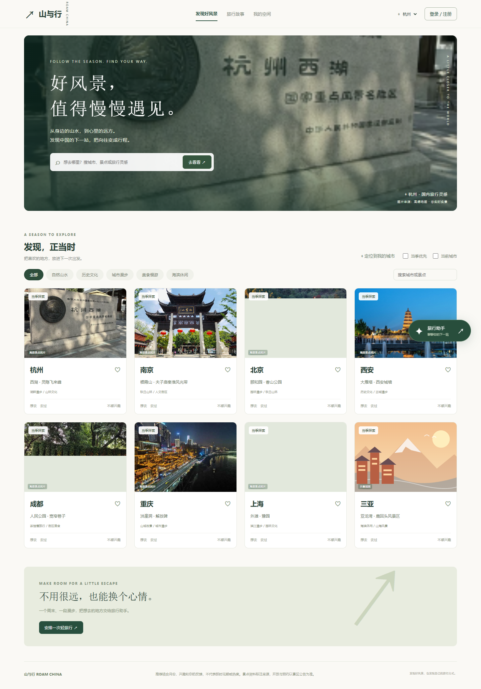
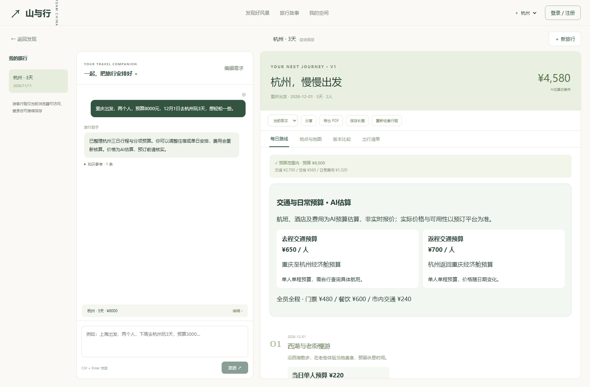
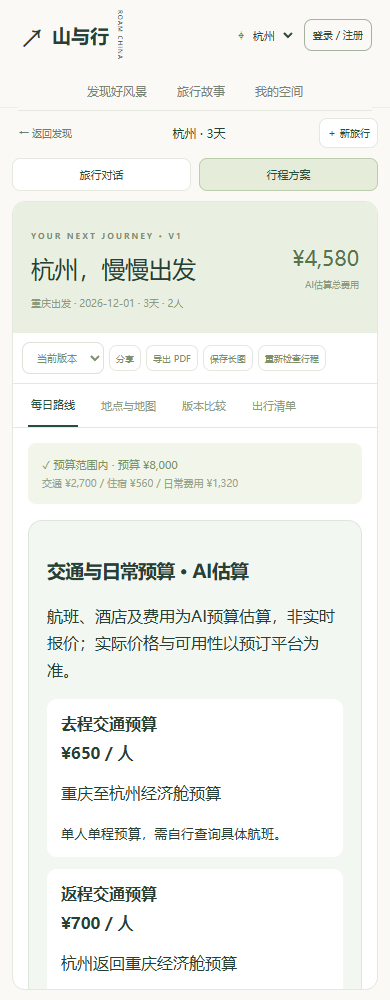
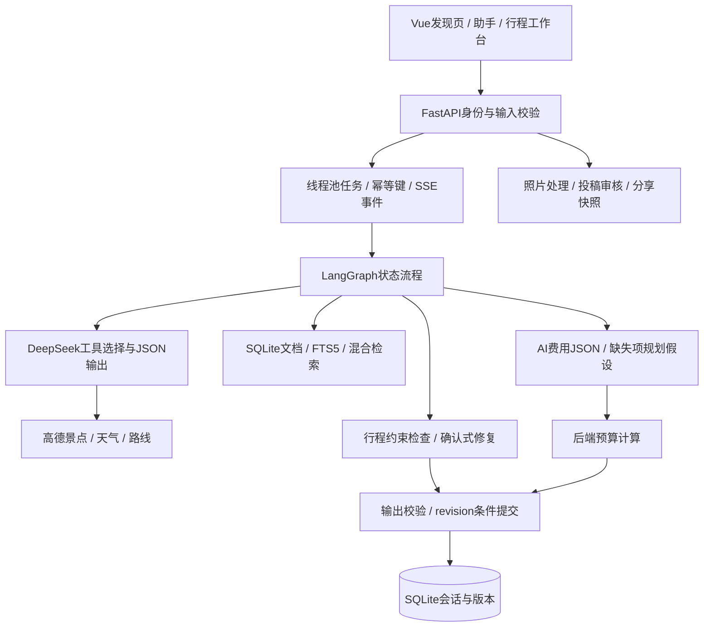

# agent-travel-planner · 山与行

面向国内旅行的发现与 AI 规划应用。从浏览风景、收藏目的地开始，通过对话补齐需求，生成包含每日路线、来源引用和分项预算的行程，再进行局部调整、版本比较与分享。

**Vue 3 · TypeScript · FastAPI · LangGraph · DeepSeek · 高德地图 · SQLite**

## 界面展示

### 发现目的地

按城市、主题和季节浏览旅行灵感，搜索全国景点，通过悬浮助手开始咨询。



### 对话规划与费用估算

工作台展示旅行对话、结构化行程、往返交通预算、住宿建议及每日开销。支持局部调整、历史版本、地图、出行清单和只读分享。



### 手机端

手机端通过“旅行对话 / 行程方案”切换视图，交通预算卡片自动纵向排列。



发现页图片为已有高德接入页面截图。工作台与手机截图使用固定演示数据展示当前界面，截图中的金额用于说明分项预算展示方式。运行时可配置自己的 DeepSeek 与高德账号。

## 功能

| 模块 | 能力 |
| --- | --- |
| 目的地发现 | 20座国内精选城市，主题与季节筛选，高德全国景点搜索与分页，用户授权定位 |
| 旅行助手 | 可拖动悬浮窗、自由咨询、多轮需求收集、确认后生成行程 |
| 工具调用 | DeepSeek 原生 Tool Calling，查询景点、天气、路线与知识库 |
| 行程规划 | 每日安排、来源引用、酒店降档/升级、指定单日调整、预算核算 |
| AI费用估算 | JSON生成往返交通、三档住宿及每日门票/餐饮/市内交通预算，记录估算依据 |
| 方案管理 | 会话持久化、版本对比与恢复、七天只读分享、撤销分享、打印/PDF与长图导出 |
| 个人空间 | 注册登录、游客行程接续、收藏夹、旅行偏好、目的地反馈、出行清单 |
| 照片与故事 | 私人草稿、照片上传、公开投稿审核、举报与下架 |
| RAG管理 | 管理员导入文本/Markdown、维护来源、自动分块、混合检索与离线评测 |

### AI费用如何生成

1. DeepSeek根据城市、日期、人数与每日路线输出JSON。去程与返程分别按单人单程估算，住宿提供经济、舒适、品质三档的每房每晚费用。
2. 每日费用拆分为单人门票、餐饮、市内交通。模型返回金额使用人民币分，后端用Pydantic验证字段、范围及日期序号。
3. 缺失金额按明确的通用规划假设补足，记录对应字段与依据。非法金额、重复日期或结构异常会拒绝本轮结果。
4. 后端按人数、房间数、晚数独立汇总费用。修改预算保留已有报价，调整酒店使用保存的候选，修改单日保留其他日期。
5. 页面、分享与导出标注AI估算。历史方案保留其原有数据来源，局部修改时明确提示混合估算。

**费用用于规划参考。模型未查询历史价格数据库，金额不代表实时余票、房态或可预订报价。** 天气、景点和路线工具返回的可靠信息单独处理，费用假设不会成为实时信息来源。

## 快速开始

需要 Python 3.11+、Node.js 22+、npm，以及支持FTS5的SQLite。默认Mock模式可离线体验主要流程。

### 克隆项目

```bash
git clone https://github.com/xiaoyuer128/agent-travel-planner.git
cd agent-travel-planner
```

### 启动后端

Windows PowerShell

```powershell
cd python
python -m venv .venv
.venv\Scripts\python -m pip install -r requirements.txt
Copy-Item .env.example .env
.venv\Scripts\python -m uvicorn api.app:app --host 127.0.0.1 --port 18000
```

macOS / Linux

```bash
cd python
python3 -m venv .venv
.venv/bin/python -m pip install -r requirements.txt
cp .env.example .env
.venv/bin/python -m uvicorn api.app:app --host 127.0.0.1 --port 18000
```

### 启动前端

在仓库根目录打开另一个终端。

```bash
cd frontend
npm ci
npm run dev
```

- 网站入口：<http://127.0.0.1:5174/#/home>
- API文档：<http://127.0.0.1:18000/docs>
- 前端开发代理将`/api`转发至`127.0.0.1:18000`。

前后端统一使用`127.0.0.1`，保持Cookie与来源配置一致。复制环境示例适用于首次安装，已有本地配置时直接编辑现有`.env`。

## 接入模型与地图

编辑`python/.env`并重启后端。

```dotenv
LLM_PROVIDER=deepseek
LLM_API_KEY=your_deepseek_api_key
LLM_BASE_URL=https://api.deepseek.com
LLM_MODEL=deepseek-flash
AMAP_API_KEY=your_amap_web_service_key
```

| 配置 | 用途 |
| --- | --- |
| `LLM_PROVIDER` | `mock`为离线示例，`deepseek`启用真实模型问答、路线生成与费用估算 |
| `LLM_API_KEY` / `LLM_BASE_URL` / `LLM_MODEL` | 模型鉴权、服务地址与账号可用模型 |
| `AMAP_API_KEY` | 高德Web服务Key，用于POI、天气、路线与地图；需对应接口权限 |
| `CHAT_DB_PATH` | 可选数据库路径，默认`python/data/chat.sqlite3` |
| `ADMIN_EMAILS` | 获得内容管理与知识库管理权限的已注册邮箱 |
| `ALLOWED_ORIGINS` | 允许访问后端的前端来源 |
| `COOKIE_SECURE` | HTTPS部署时设为`true` |

完整示例见[python/.env.example](python/.env.example)。密钥由后端读取，`.env`、数据库和上传文件在Git忽略规则中。服务商鉴权、余额、限流和输出异常会返回明确错误。

- [DeepSeek文档](https://api-docs.deepseek.com/)
- [高德Web服务文档](https://lbs.amap.com/api/webservice/summary/)

## RAG知识库与评测

注册账号后，在`python/`目录配置管理员并重启后端，重新登录后进入“内容管理”。

```powershell
.venv\Scripts\python manage_admin.py your_registered_email@example.com
```

macOS/Linux使用`.venv/bin/python`。管理员可以录入标题、城市、来源和正文，或导入`.md`/`.txt`资料，删除资料时同步移除索引。

检索链路为中文词项处理与查询扩展 → BM25/字符TF-IDF双路召回 → RRF融合 → 标题/城市规则重排 → 文档去重。检索片段在生成前注入模型上下文，引用编号限定于本轮提供的来源。

在`python/`目录运行离线评测。

```bash
python -m rag.evaluation --output rag_eval_report.json
```

固定集合包含41份文档、40条正例与4条无资料问题，正例包含20条改写问题。评测使用独立临时数据库，不修改业务知识库、不调用付费模型，记录逐题结果、数据集/语料哈希、Recall@3、MRR@3、nDCG@3与空召回率。

| 指标 | BM25 | 混合检索 |
| --- | --- | --- |
| 40条正例Recall@3 | 87.5% | 95% |
| 20条改写问题Recall@3 | 75% | 90% |
| 4条无资料问题正确空召回率 | 75% | 75% |

以上为固定人工合成集合的检索结果，详细记录见[参考评测报告](python/rag/evaluation_reference.json)。回答质量还需要检查内容支持、引用和用户约束，引用ID有效不能直接推导回答正确。

## 架构与任务生命周期



当前应用采用**单主Agent结合LangGraph显式流程**。自由咨询按需检索与调用工具；完整规划依次进行需求理解、缺项收集、检索、路线与费用生成、约束检查及回应。检测到冲突时最多生成一次修复建议，由用户确认后应用。

- **流式与取消**：SSE展示文字草稿与进度，校验完成后保存正式结果。取消信号与最终提交按锁排序，提交完成后的取消不撤销已保存版本。
- **幂等与接续**：同键同内容复用任务，事件按序号接续，避免网络重连重复启动模型请求。
- **容量范围**：单进程4个工作线程，最多保留64个任务对象。终态任务按创建时间和TTL清理，当前TTL为900秒，清理在新任务接入时进行。
- **恢复范围**：会话与方案版本持久化，运行任务与事件保存在内存。服务重启后中间任务不能继续接续，多实例需额外共享队列与事件存储。
- **约束检查**：检查已知地点、交通耗时、简单开放区间、重复景点与每日强度，缺资料时标为待核实。冲突减少的修复候选需确认后保存。
- **数据隔离**：Cookie身份、owner过滤与revision乐观锁保护个人资源。分享为七天只读快照，可撤销，不含私人对话。
- **图片处理**：校验JPEG/PNG/WebP、8MB大小与像素限制，重编码清除EXIF/GPS，私图按归属鉴权，公开内容先审核。

## 目录

```text
.github/assets/                  # README界面截图
frontend/src/
  Platform.vue                   # 当前应用入口
  components/TravelConversation.vue
  components/JourneyBoard.vue    # 行程与预算展示
  api/stream.ts                  # SSE任务客户端
  types/chat.ts                  # 会话与方案类型
python/
  api/app.py                     # FastAPI入口
  api/discover.py                # 国内推荐与高德搜索
  chat/graph.py                  # LangGraph流程
  chat/deepseek.py               # 模型、工具协议与JSON适配
  chat/estimates.py              # 费用Schema、缺失补足与来源标记
  chat/planner.py                # 局部修改与预算汇总
  chat/jobs.py                   # 任务、取消与最终提交
  chat/store.py                  # 会话持久化与乐观锁
  rag/library.py                 # 知识库与混合检索
  rag/evaluation.py              # 离线检索评测
  community/                    # 账户、收藏、图片、审核、分享
  tests/                        # 自动化回归
```

默认网站通过`/api/chat`调用当前流程。`agents/`、`orchestrator/`、`/api/plan`、Java、Go及旧界面保留为兼容实现，详细后端入口说明见[Python README](python/README.md)。

## 测试与验证

在后端虚拟环境执行以下命令。

```bash
cd python
python -m pytest tests -q
```

前端执行类型检查与生产构建。

```bash
cd frontend
npm run build
```

2026-11-11验证记录

- **98项自动化测试通过**，覆盖需求收集、预算、引用、局部调整、账户隔离、版本恢复、分享、图片及任务状态。
- 费用回归包含JSON模式、缺失补足、非法金额、重复/越界日期、局部修改、失败不落库与导出。
- 前端类型检查与构建通过，桌面及390px手机页面完成费用展示与历史方案兼容检查。
- 一次真实DeepSeek费用生成返回2段交通、3档住宿及2天分项费用，通过服务端校验。

自动化测试使用Mock供应商与临时数据库，真实服务调用单独验收。测试数量反映执行项数，生产容量和真实用户推荐效果需要另行评估。

## 数据与运行说明

默认数据库位于`python/data/chat.sqlite3`，照片位于数据库相邻的`uploads/`目录。备份时同时保存数据库和图片，版本更新前先保留本地数据。

推荐按月份、主题、用户兴趣与反馈排序。景点图片来源单独标注，历史照片不代表当前实景，花期、开放时间和预约需要核实。Mock模式使用演示数据，DeepSeek模式的费用也属于预算估算。

公网部署需配置HTTPS、代理流式响应、允许来源、持久存储与备份。当前任务和幂等记录有单进程边界，部署多实例前需相应调整。
