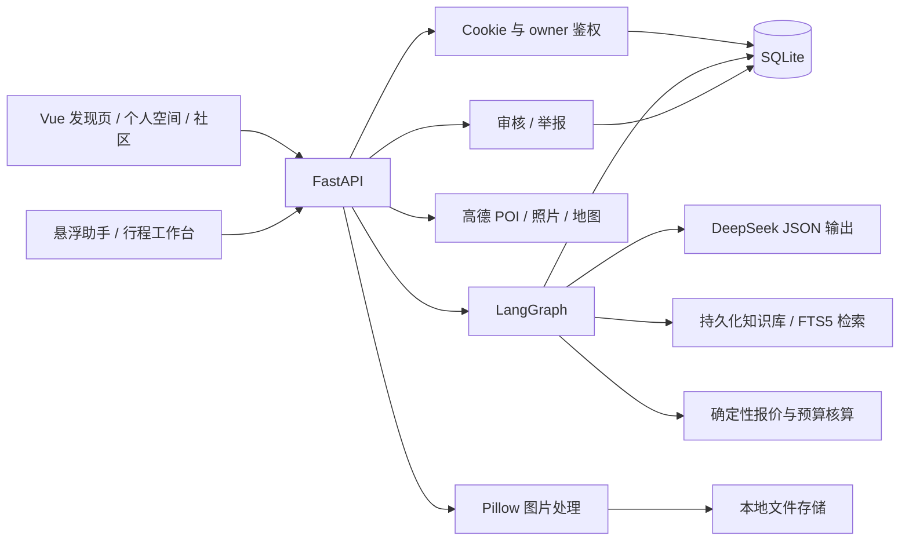

# 山与行 · 国内旅行发现与 AI 规划平台

一个面向国内旅行场景的全栈应用：从发现风景、收藏目的地开始，通过对话确认需求，生成可调整、可比较、可分享的结构化行程，再用照片与游记记录旅行。

**Vue 3 · TypeScript · FastAPI · LangGraph · DeepSeek · 高德地图 · SQLite**

## 功能

### 发现与个人空间

- 20 座国内精选城市的发现首页、景点详情、主题/季节/城市筛选；高德全国地点实时搜索与分页，不限于精选城市。
- 高德景点资料与照片；缺图或接口不可用时显示明确标注的示例与插画。
- 用户主动授权定位，转换坐标并识别城市；也支持手动选择。
- 邮箱账号注册、登录与退出，游客行程在登录后接续到当前账户。
- 收藏城市、景点和游记，创建收藏夹，从同城收藏发起行程规划。
- 保存出发城市、预算、人数、兴趣、节奏、交通、步行强度和特殊需求。
- “想去 / 去过 / 不感兴趣”反馈参与推荐排序，支持撤销。

### 对话与行程工作台

- 可拖动的悬浮旅行助手，支持自由咨询与知识问答，不要求先填写行程条件；需要完整方案时再确认条件并进入工作台。
- DeepSeek 理解需求，并基于检索到的本地攻略生成结构化每日路线。
- 酒店局部调整、指定某一天修改；预算由程序独立核算，不由模型编造折扣。
- 会话、需求与方案版本持久化；支持版本比较和恢复为新版本。
- 按每日引用关联高德地点、静态地图与导航入口。
- 可撤销的只读分享快照，有效期七天，不包含私人聊天。
- 浏览器打印 / 保存 PDF、导出长图，以及可保存的出行清单。
- 桌面工作台分栏，手机通过“旅行对话 / 行程方案”标签切换。

### 照片与旅行故事

- 上传 JPEG / PNG / WebP，单张最多 8MB，校验实际格式及像素数量。
- 自动处理图片方向、去除 EXIF/GPS，生成主图与缩略图。
- 私人旅行足迹、草稿、图片集、编辑和删除，分别记录旅行日期与发布时间。
- 公开内容先审核后展示；修改后重新审核，支持举报、下架和审核日志。
- 私图按归属鉴权，公开照片仅在关联内容审核通过后对外提供。

## 真实接口与演示边界

| 能力 | 当前实现 |
| --- | --- |
| 需求理解、路线生成 | 可接入真实 DeepSeek；默认 Mock 可离线体验 |
| 景点资料、照片、坐标、静态地图 | 已接入高德，需自行配置 Web 服务 Key 与相应权限 |
| 推荐与搜索 | 20 个国内精选城市 + 高德全国景点检索；推荐依据月份、主题、兴趣与反馈，不是实时热门榜 |
| RAG 知识库 | SQLite 持久化文档与重叠分块，中文双字切分 + FTS5/BM25 检索；管理员可导入 Markdown/文本，回答与方案校验引用 ID |
| 航班、酒店、费用 | 示例候选与演示报价，不支持预订，也不是实时余票或库存 |
| 持久化 | 本地 SQLite 与图片文件；不是云数据库或对象存储 |
| 公开内容审核 | 人工审核，未接入 AI 图片审核服务 |
| 邮箱账号 | 邮箱作为登录标识，尚未接入邮箱验证、邮件发送与密码找回 |

图库照片不能代表当前实景；花期、天气、开放时间、门票和预约应查询实际公告。本项目不提供实时预订能力。

## 快速开始

建议使用独立的 Python 3.11+ 环境、Node.js 22+ 和 npm。

### 1. 克隆仓库

```bash
git clone https://github.com/xiaoyuer128/multi-agent-travel-planner.git
cd multi-agent-travel-planner
```

### 2. 启动后端

在 `python/` 目录下创建环境并安装依赖。

Windows PowerShell：

```powershell
cd python
python -m venv .venv
.venv\Scripts\python -m pip install -r requirements.txt
Copy-Item .env.example .env
.venv\Scripts\python -m uvicorn api.app:app --host 127.0.0.1 --port 18000
```

macOS / Linux：

```bash
cd python
python3 -m venv .venv
.venv/bin/python -m pip install -r requirements.txt
cp .env.example .env
.venv/bin/python -m uvicorn api.app:app --host 127.0.0.1 --port 18000
```

默认 `LLM_PROVIDER=mock`，不需要模型密钥。配置真实接口后，重启后端。

### 3. 启动前端

另开终端，在仓库根目录执行：

```bash
cd frontend
npm ci
npm run dev
```

- 网站：<http://127.0.0.1:5174/#/home>
- API 文档：<http://127.0.0.1:18000/docs>
- Vite 开发代理：`/api` → `http://127.0.0.1:18000`。

前后端请统一使用 `127.0.0.1`，避免混用 `localhost` 导致 Cookie 或来源配置不一致。

## 接入 DeepSeek 与高德

编辑后端 `python/.env`：

```dotenv
LLM_PROVIDER=deepseek
LLM_API_KEY=填写自己的密钥
LLM_BASE_URL=https://api.deepseek.com
LLM_MODEL=deepseek-flash
AMAP_API_KEY=填写自己的高德Web服务密钥
```

密钥只在后端读取，`.env` 不提交 Git，也不返回浏览器。接口能否使用、额度及费用以服务商账号权限为准。

- [DeepSeek 官方文档](https://api-docs.deepseek.com/)
- [高德地点搜索](https://lbs.amap.com/api/webservice/guide/api/search/)
- [高德静态地图](https://lbs.amap.com/api/webservice/guide/api/staticmaps)

DeepSeek 的鉴权失败、余额不足、限流、超时或结构校验失败会返回明确错误，当前轮次不会静默伪装成模型生成成功，也不会保存半成品。

## RAG 知识库

配置管理员后，进入“内容管理 → RAG 知识库”，填写标题、适用城市、来源名称与可选链接，粘贴正文或导入 `.md` / `.txt` 文件。保存后自动分块并建立检索索引，支持删除资料及对应索引。

- 文档、分块、来源与索引持久保存在 SQLite，重启后仍可检索。
- 中文双字切分改善 SQLite 默认分词对中文连续文本的匹配，使用 FTS5/BM25 排序；不需要额外的向量模型密钥。
- 普通咨询和完整行程都会先检索资料，再将命中片段交给 DeepSeek；输出引用只能使用本轮检索到的 ID。
- 对话下方可展开“知识参考”，查看命中资料与来源；有有效 HTTP 来源链接时可打开原文。
- 初始资料为内置编辑参考，不等于实时权威资讯。管理员应录入有权使用、已核实的内容；系统不会自动抓取任意网站。
- 此版本采用全文检索式 RAG，**不是 BGE/Milvus 向量检索**。需要 Python 的 SQLite 构建支持 FTS5。

普通咨询无需预算、人数、日期；只有生成完整结构化行程时才要求必要条件。Mock 模式提供基础示例回复，真实自由问答需要配置 DeepSeek。

## 账户、管理员与数据

注册自己的邮箱账号后，在 `python/` 下执行：

```powershell
.venv\Scripts\python manage_admin.py 你已注册的邮箱
```

重启后端并重新登录，导航会出现“内容管理”。macOS / Linux 使用 `.venv/bin/python`。管理员由本地配置 `ADMIN_EMAILS` 指定，网页不能自行提权；未配置管理员时，公开投稿会保持待审核。

默认数据位置：

```text
python/data/chat.sqlite3     # 账户、会话、版本、收藏、游记等
python/data/uploads/        # 已处理图片与缩略图
```

通过 `CHAT_DB_PATH` 可更换数据库路径；图片保存在该数据库相邻的 `uploads/` 下。备份时同时备份数据库与图片文件。历史未归属账户的演示会话保持隔离，不会被任意新访客认领。

账户使用随机盐 scrypt 密码哈希、服务端令牌摘要和 HttpOnly/SameSite Cookie。会话、收藏、草稿、上传与清单按 owner 进行权限校验；版本更新使用 revision 乐观锁。

部署到 HTTPS 环境时设置 `COOKIE_SECURE=true`，并把 `ALLOWED_ORIGINS` 设置为实际前端来源。当前开发代理配置不是完整的公网部署方案；仍需自行配置 HTTPS、反向代理、数据备份及服务运维。

## 架构



对话图分为两个入口：自由咨询 `retrieve_knowledge → chat`；完整方案 `understand → collect → retrieve → planning → respond`。只有完整方案分支补齐必要字段，普通咨询不强制补槽；完整业务状态在一轮完成后原子保存。当前不是 LangGraph 节点级 checkpoint，不支持从中断图节点恢复。

```text
frontend/src/
  Platform.vue                    # 默认应用入口与产品流程
  components/TravelConversation.vue
  components/JourneyBoard.vue
  api/platform.ts                 # 账户、内容与对话客户端
  styles/platform.css             # 响应式页面
python/
  api/app.py                      # FastAPI 入口
  api/discover.py                 # 高德与国内目的地
  chat/                           # 图编排、模型适配、方案与会话存储
  community/                      # 账户、收藏、图片、审核、分享、地图
  rag/library.py                  # 持久化 RAG 文档、分块与全文检索
  api/knowledge.py                # 知识库管理与检索接口
  domestic.py                     # 国内编辑参考资料
  manage_admin.py                 # 管理员配置工具
  tests/                          # 自动化测试
```

`agents/`、`orchestrator/`、`/api/plan` 和 `/api/plan/full` 为旧版 Pipeline 的兼容实现，默认页面通过 `/api/chat` 调用新的 LangGraph 流程。Java、Go 和旧版界面保留为历史实现，不是当前网站必需的启动服务。

## 测试与验证

在 `python/` 目录中：

```powershell
.venv\Scripts\python -m pytest tests -q
```

测试配置固定使用 Mock 模型和独立临时数据库，不读取真实会话、不消耗模型额度。真实高德与 DeepSeek 的网络验收独立进行。

前端：

```bash
cd frontend
npm run build
```

最近验证（2026-11-10）：

- **68 项自动化测试通过**：覆盖多轮需求、预算、引用校验、局部修改、版本恢复、账户隔离、游客接续、私图鉴权、审核、分享快照/撤销/到期等。
- 前端类型检查与生产构建通过；新增测试覆盖持久化中文检索、资料权限、虚构引用拒绝与全国地点搜索。
- 浏览器完成注册 → 收藏 → 真实 DeepSeek 规划 → 分享/撤销 → 清单 → 私人照片草稿流程。
- 首页检查 2048 / 1440 / 1024 / 768 / 390px 宽度；工作台检查 1440 / 1024 / 390px 宽度。
- 真实高德静态地图返回 HTTP 200；长图已实际下载。另实测助手拖动、泉州景点搜索、真实 DeepSeek 自由回复与 RAG 引用。

通过按需注册 Element Plus 对话框与样式拆分，首次优化测量中构建 JS 从约 **1093 KB 减至 194 KB**，CSS 从约 **390 KB 减至 40 KB**（未 gzip，不含图片和 API 数据；新增搜索与知识库功能后产物会有所增加）。这只是构建体积测量，不代表同等比例的加载时间或线上性能提升。

尚未进行生产并发容量、模型推荐质量或真实用户转化率评测。所有本地账户、上传文件、密钥和个人简历材料均不随源码发布。
